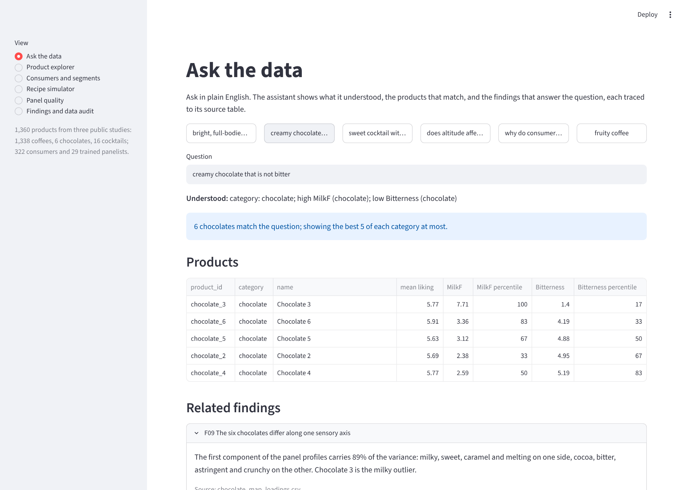
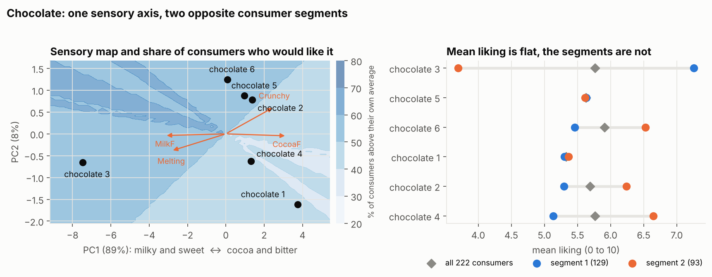
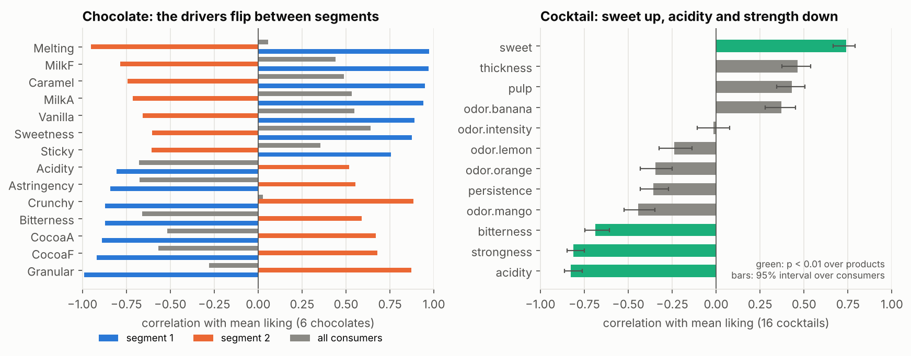
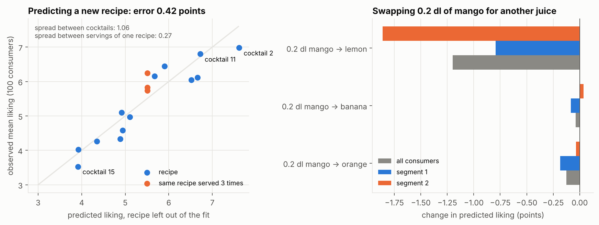
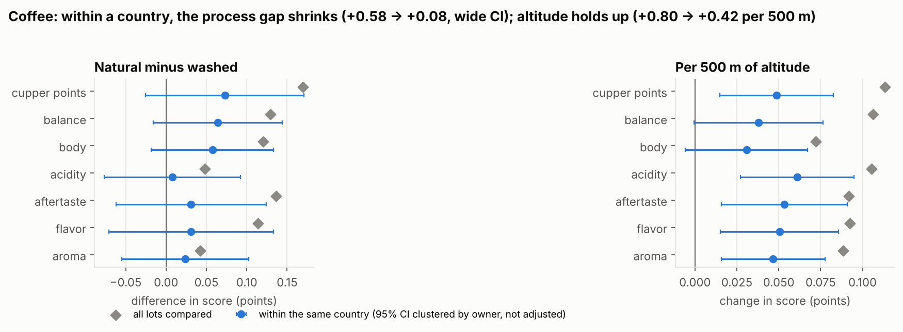
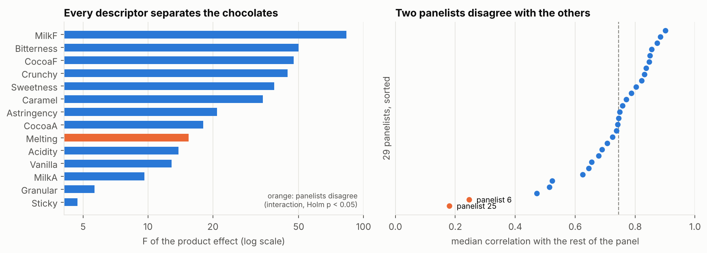
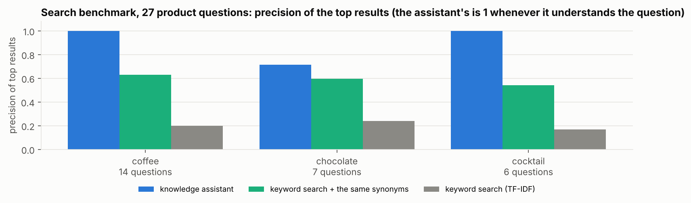
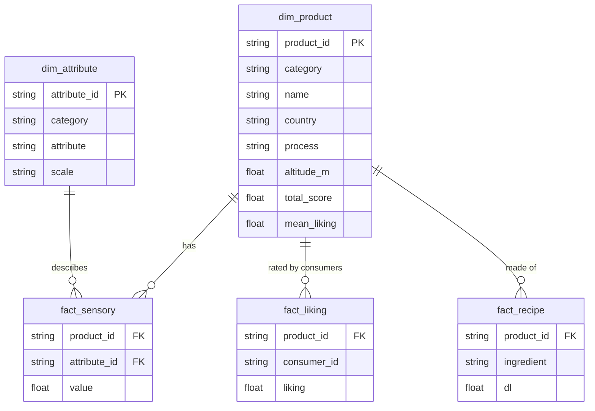
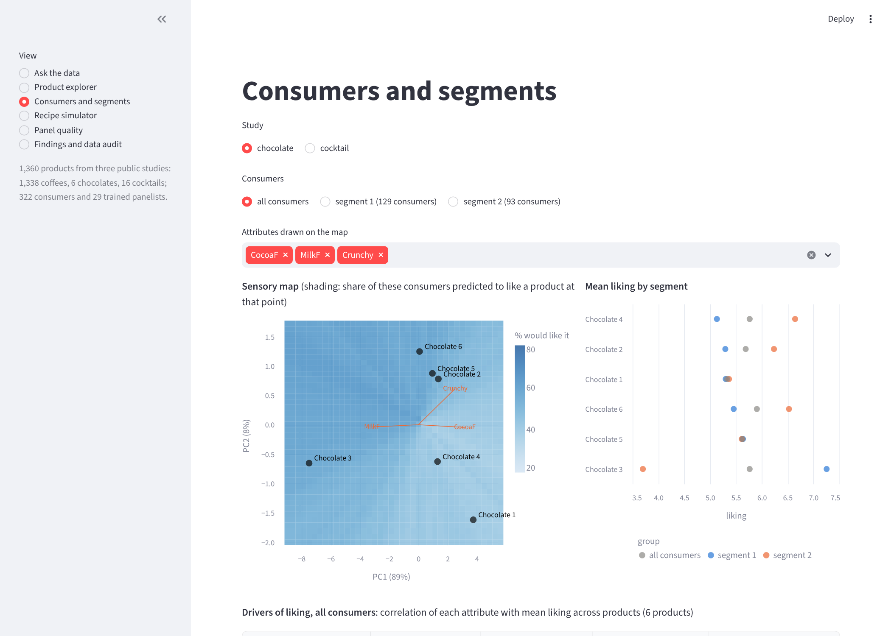

# Sensory knowledge hub

[](https://github.com/Abderrahmane-BOULAMI/sensory-knowledge-hub/actions/workflows/tests.yml)

Product teams keep sensory and consumer knowledge in many places: panel profiles in one file, consumer tests in another, recipes somewhere else, and conclusions in slide decks. This project connects three public studies into one data model, puts them behind a dashboard, and lets anyone ask a question in plain English and get products and findings that are traced back to the source tables.

| Study | What it contains |
|---|---|
| Coffee | Coffee Quality Institute cupping scores: 1,338 lots, 10 attributes, origin, process, altitude |
| Chocolate | A trained panel (29 panelists x 6 chocolates x 2 sessions, 14 descriptors) and the liking of 222 consumers |
| Cocktail | The recipe of 16 cocktails (4 juices), their panel profile (13 descriptors) and the liking of 100 consumers |



## What it does

- **Connects the data.** One star schema (products, attributes, sensory scores, liking, recipes), stored in SQLite and exported as CSV files for Power BI. Every data problem found on the way is fixed in code and reported.
- **Answers questions in plain English (AI-assisted search).** A natural-language search assistant maps a question to attributes, directions and filters with a sensory lexicon, ranks the matching products and retrieves the relevant findings. It shows what it understood, and says so when the data does not measure what was asked. It runs locally, with no external service.
- **Explains liking with machine learning and statistics.** Sensory maps (PCA), consumer segments (clustering), preference maps and drivers of liking, with the statistics a sensory scientist would expect: panel performance, permutation tests, confidence intervals.
- **Supports product renovation.** A predictive mixture model estimates the sensory profile and liking of a new cocktail recipe, per consumer segment, with an honest error estimate.
- **Is reproducible.** One command rebuilds every result, 19 automated tests run on every change, and a dashboard smoke test checks every page.

## Key findings

1. **Average liking hides two opposite chocolate segments.** Mean liking ranges only from 5.3 to 5.9 out of 10, as if no chocolate stood out. But consumers split into two segments of 129 and 93: chocolate 3, the milky one, scores 7.3 in the first and 3.7 in the second. The shared preference axis is real (34% of the liking variance, against a 95th percentile of 27% for shuffled data, p < 0.001) and it is the panel's sensory axis itself (correlation 0.99). The boundary is soft (silhouette 0.19): consumers spread along that axis rather than forming two separate clusters.

2. **Read on averages, nothing drives chocolate liking; read by segment, the drivers flip.** No attribute correlates with mean liking at p < 0.05 over the six chocolates. Within segments, melting correlates +0.97 with liking in the first segment and -0.95 in the second; crunchy goes -0.87 and +0.88. The flip partly follows from how the segments are formed (along the same sensory axis), so it describes the segments; it is not a separate test.

3. **Cocktail liking is predictable from the recipe.** A mixture model of the four juice proportions predicts the mean liking of a recipe it has not seen with an error of 0.42 points (leave-one-recipe-out), against 1.06 points of spread between cocktails and 0.27 between three servings of the same recipe. Lemon costs the most: replacing 0.2 dl of mango with lemon lowers predicted liking by 1.2 points, and a segment of 38 consumers rates the most lemony cocktails 3.4 against 7.0 for those without lemon.

4. **No untested recipe is predicted to beat the best cocktail.** Searching every recipe inside the tested range, the model's optimum is exactly cocktail 2 (no lemon, least orange), already the most liked. A linear mixture model always puts its optimum at a corner of the tested range, so what it offers is a direction for the next tasting (less orange, no lemon, beyond the tested range), to be confirmed by consumers.

5. **In the coffee data, the "natural process" advantage cannot be separated from origin.** Natural coffees score 0.39 points above washed ones across all arabica lots, and 0.58 in the 11 countries that use both. Compared within the same country, the gap falls to 0.08 points, but with a wide interval (95% CI -0.63 to +0.78, clustered by owner): the data can neither confirm nor rule out a real process effect, and the raw gap should not be quoted as one. Altitude holds up: +0.42 points per 500 m within country (95% CI +0.14 to +0.70), about half the raw slope, with acidity rising the most.

6. **The ten coffee attributes mostly repeat one signal.** The first principal component carries 72% of the variance of the seven graded attributes, and uniformity, clean cup and sweetness are 10 out of 10 for 86 to 91% of lots. The total score is simply the sum of the ten attributes, so any model "predicting" the total from them is circular.

7. **The chocolate panel is reliable, with three panelists to check.** All 14 descriptors separate the six chocolates at p < 0.001. Panelists disagree significantly only on melting (Holm-corrected interaction). Two panelists agree with the others at a median correlation of 0.18 and 0.25, against 0.75 for the median panelist, and a third separates the products on none of the 14 descriptors on their own scores (median panelist: 4).

8. **The data needed fixing first.** 35 coffee altitudes are recording errors (a value of "1901.64" stored as 190,164 m), the harvest year comes as 46 distinct entries (such as "4T/10" or "Mayo a Julio"), one lot has every score at zero, and the cocktail colour scores are not explained by the recipe at all: three servings of the same recipe score 8.2, 3.5 and 3.1. The chocolate liking scale is also documented in the opposite direction to the cocktail one; the choice made here is stated in the findings.

All 16 findings, with their source tables, are in [`results/findings.csv`](results/findings.csv) and in the dashboard.

## Figures

| | |
|---|---|
|  |  |
|  |  |
|  |  |

## The search assistant, and how well it works

A question goes through two steps, and the answer always shows the first one:

1. **Understand.** A sensory lexicon maps words to attributes ("bright" and "tangy" to acidity, "creamy" to milk flavour, "full-bodied" to body for coffee and thickness for a drink), negations to a direction ("not bitter", "without lemon"), and the rest to filters (origin, process, altitude, species).
2. **Retrieve.** Matching products are ranked on the requested attributes (z-scores within the category) and findings are retrieved by TF-IDF on the question expanded with the lexicon.

It was measured on 32 plain-English questions written by the authors ([`sensehub/benchmark.py`](sensehub/benchmark.py)): 27 ask for products, 5 ask for something the data does not contain. The relevant products for each question come from its specification alone (the filtered products in the top quarter on the requested attributes).

| | Result |
|---|---|
| Questions understood | 30 of 32 |
| Product questions: precision of the top results, assistant | 93% |
| Same questions, keyword search with the same synonyms added | 60% |
| Same questions, plain keyword search (TF-IDF over product descriptions) | 20% |
| Unanswerable questions where the assistant says so | 5 of 5 |

How to read it: the assistant ranks with the same scores that define relevance, so once it understands a question its precision is 1, and its 93% is the share of product questions it understood. The comparison shows what is lost by matching words instead of meaning: even with the synonyms, keyword search cannot apply a direction ("not bitter") or a filter ("above 2,000 m"). The questions were written by the same people as the lexicon, and one parser bug found by the benchmark was fixed (the word "lots" was read as coffee lots), so a question set written by someone else would be the next step.

The two failures are kept: "the crunchiest chocolate" (superlatives are not in the lexicon) and "which chocolate do consumers like most" ("like most" is not recognised as a ranking request).

**Why no generative model.** The assistant is AI in the sense of natural-language understanding and information retrieval: rule-based language parsing with a sensory lexicon, then TF-IDF retrieval. It uses no generative model on purpose, so that every answer can be traced to a table row and nothing is invented. A large language model could sit on top of it later, to phrase answers or handle wider vocabulary, with this layer kept as its source of facts.

The limit of the lexicon approach is the lexicon itself: a word it does not know is ignored, which the answer makes visible ("Understood: ...").

## Connected data model



**Power BI.** The five tables are in [`powerbi/`](powerbi). In Power BI Desktop: Get data, Text/CSV, load the five files, then link `product_id` from `dim_product` to the three fact tables and `attribute_id` from `dim_attribute` to `fact_sensory` (one to many). The same tables are in `results/knowledge.db` (SQLite) after running the experiments.

## Method

- **Data** ([`sensehub/data.py`](sensehub/data.py)): cleaning and audit of the coffee table, conversion of the three studies to one star schema, export to SQLite and CSV.
- **Panel performance** ([`sensehub/panel.py`](sensehub/panel.py)): two-way ANOVA per descriptor, with the product effect tested against the product x panelist interaction; per panelist, discrimination, repeatability and leave-one-out agreement with the rest of the panel.
- **Consumers** ([`sensehub/mapping.py`](sensehub/mapping.py)): standardised PCA of the panel profiles; Ward clustering of centred liking, with the number of segments chosen by silhouette; a permutation test of shared preference structure; external preference mapping (vector model for 6 chocolates, circular model for 16 cocktails); drivers of liking with intervals that resample consumers and p-values over products.
- **Recipes** ([`sensehub/recipe.py`](sensehub/recipe.py)): Scheffé mixture models (linear or quadratic, chosen per response by leave-one-recipe-out error, with replicated recipes left out together), compared with the replicate noise; search of the best recipe inside the tested range.
- **Coffee** ([`sensehub/coffee.py`](sensehub/coffee.py)): within-country comparisons with country fixed effects, standard errors clustered by owner (lots from one owner are not independent), Holm correction across attributes.
- **Search** ([`sensehub/search.py`](sensehub/search.py), [`sensehub/benchmark.py`](sensehub/benchmark.py)): described above.

## Run it

```bash
pip install -r requirements.txt
python experiments/run_all.py        # about 1 minute, writes results/
python experiments/plot_results.py   # writes results/figures/
pytest -q                            # 19 tests
streamlit run app/dashboard.py       # dashboard
```

The dashboard has six views:

- **Ask the data**: plain-English questions, with the benchmark behind them.
- **Product explorer**: filter coffees by origin, process and altitude, compare profiles; profile heat maps for chocolates and cocktails.
- **Consumers and segments**: sensory map with the preference map of each segment, liking by segment, drivers of liking.
- **Recipe simulator**: set a cocktail recipe, see the predicted profile and liking per segment, with a warning outside the tested range.
- **Panel quality**: descriptors, panelists, and any panelist against the rest of the panel.
- **Findings and data audit**: all findings with their sources, the audit figures and the data model.



## Tests

The 19 tests cover:

- the coffee cleaning against the audit figures, the referential integrity of the data model and both exports;
- the panel ANOVA (it finds a planted product effect and not a missing one; it refuses an unbalanced design) and the detection of a random panelist;
- the sensory map, the recovery of planted consumer segments, the permutation test with and without structure, the preference map and drivers;
- the mixture models (exact coefficients on noiseless data, the right model choice, replicates kept together in validation, the recipe grid), and that the cocktail liking model beats the spread between products;
- the Holm correction, robust and cluster-robust regression, and the removal of a planted country confound;
- the parser (negation stops at a comma or "but", a phrase from another category does not hide a shorter one, excluded origins, several processes, feet and altitude ranges), filters and abstention of the search assistant, and a regression guard on the benchmark.

## Limitations

- The chocolate and cocktail studies are small (6 and 16 products). Product-level conclusions rest on few points, which is why p-values over products are reported next to intervals over consumers.
- Consumer segments are a convenient summary of a continuum, not fixed groups.
- The recipe model is valid inside the tested range only; the simulator warns outside it.
- The coffee scores come from many cuppers and years; within-country comparisons remove origin effects, not every confounder.
- The search assistant understands English and the words in its lexicon. It does not generate text: every sentence it returns is a stored finding or a table row.
- Segment drivers are descriptive: the segments come from the same liking data.

## Data

- Coffee: Coffee Quality Institute review pages, collected by James LeDoux ([coffee-quality-database](https://github.com/jldbc/coffee-quality-database)) and republished by [TidyTuesday](https://github.com/rfordatascience/tidytuesday/tree/master/data/2020/2020-07-07) (`data/coffee_ratings.csv`).
- Chocolate and cocktail: the `chocolates` and `cocktail` data sets of the SensoMineR R package (Husson, Lê and others; GPL-2 or later), from Institut Agro / Agrocampus Rennes. The original `.rda` files are in `data/raw/`; `data/convert_rda.py` rebuilds the CSV files.

## Authors

Abderrahmane BOULAMI and Kawtar BELLAMINE, Arts et Métiers ParisTech.
